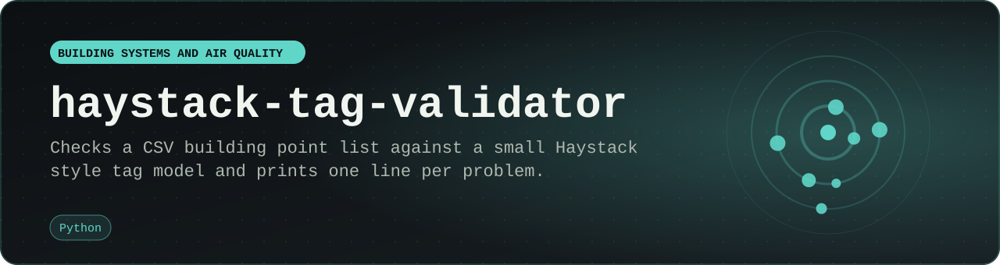
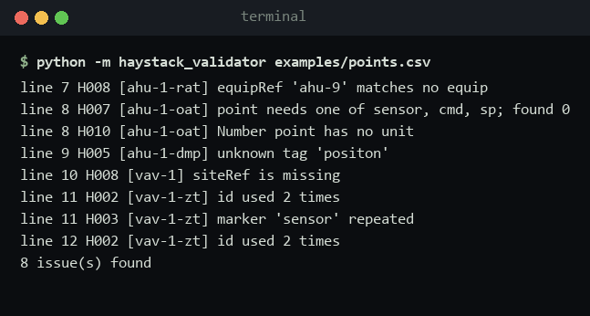

<p align="center"></p>

# haystack-tag-validator

[](https://github.com/yassine2med/haystack-tag-validator/actions/workflows/ci.yml)  

Checks a CSV building point list against a small Haystack style tag model and prints one line per problem.



## What it is for

Building point lists exported from a controls vendor or a CMMS (maintenance management system) often carry free-form tags that break analytics later: a point with no equipment link, a typo in a tag, a Number with no unit. A facility or controls coordinator runs this tool on the list before it is loaded into a dashboard or an asset register. They get a numbered list of exact rows to fix instead of finding the errors after the data is live.

## Install

```
git clone <this repo> && cd haystack-tag-validator
python -m pip install -r requirements.txt
python -m pytest -q
```

## How to use

| I want to | Command |
|---|---|
| Validate the sample point list | `python -m haystack_validator examples/points.csv` |
| Validate my own file | `python -m haystack_validator path/to/points.csv` |

The tool takes one file and has no other options. The exit code is 1 when any issue is found, 0 when clean, 2 on bad usage. Input columns: `id, dis, markers, equipRef, siteRef, kind, unit`. `markers` is a space separated list of tags. The sample data in `examples/points.csv` is invented (Building A, AHU-1, VAV-1).

Worked example:

```
python -m haystack_validator examples/points.csv
```

```
line 7 H008 [ahu-1-rat] equipRef 'ahu-9' matches no equip
line 8 H007 [ahu-1-oat] point needs one of sensor, cmd, sp; found 0
line 8 H010 [ahu-1-oat] Number point has no unit
line 9 H005 [ahu-1-dmp] unknown tag 'positon'
line 10 H008 [vav-1] siteRef is missing
line 11 H002 [vav-1-zt] id used 2 times
line 11 H003 [vav-1-zt] marker 'sensor' repeated
line 12 H002 [vav-1-zt] id used 2 times
8 issue(s) found
```

## How it works

- Rows are read with the csv module. A first pass maps each id to its entity tag (site, space, equip or point).
- H001 and H002: every row needs a unique id.
- H003 to H005: markers must not repeat, must look like camelCase names, and must be in a bundled vocabulary of 66 HVAC tags (`src/haystack_validator/tags.py`).
- H006: a row needs exactly one entity tag.
- H007: a point needs exactly one of `sensor`, `cmd`, `sp`.
- H008: a point needs an `equipRef` that matches an equip row, and an equip needs a `siteRef` that matches a site row.
- H009 and H010: a point needs a `kind` of Number, Bool or Str, and a Number needs a unit.

## Limits

- It checks a CSV with the columns above, not Zinc or JSON Haystack files.
- The vocabulary is a small subset, not the full Project Haystack defs. Unknown tags are reported, which may be a false alarm for tags outside HVAC.
- It does not check units against quantities or validate the tag combinations in the official ontology.

## License

MIT. See LICENSE. Yassine Emhamed, 2026.
